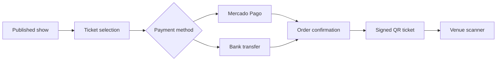

# CAPITAN Tickets

A full-stack ticketing platform for CAPITAN shows. Visitors can discover upcoming dates, buy or claim tickets and receive a QR credential; administrators manage shows, orders, guests, payments and venue check-in.

[Live site](https://capitan-tickets.vercel.app)

## Product capabilities

- Public catalogue for published shows and ticket tiers.
- Mercado Pago checkout plus bank-transfer confirmation flow.
- QR ticket generation and venue-side scanning.
- Invite links with claim flows for guest tickets.
- Admin views for shows, orders, guests and ticket status.
- Clerk authentication with an email-based admin allowlist.
- PostgreSQL persistence through Prisma.
- Google Sheets synchronization and email notifications.

## Stack

Next.js 16 · React 19 · TypeScript · Tailwind CSS · Prisma · PostgreSQL · Clerk · Mercado Pago · Google APIs

## Main flows



The application also supports invitation claims, archived shows, guest lists, payment evidence and administrative order updates.

## Run locally

```bash
npm install
npx prisma generate
npm run dev
```

The application requires a PostgreSQL database and environment values for Clerk, payment processing, signed tickets, email and optional Google Sheets synchronization. Keep service credentials and signing secrets outside source control.

## Useful commands

```bash
npm run db:migrate
npm run db:seed
npm run lint
npm run build
```

## Repository map

```text
src/app/              Public, payment, ticket, scanner and admin routes
src/app/api/          Checkout, webhook, ticket and admin endpoints
src/components/       Purchase, order, scanner and administration UI
src/lib/              Database, auth, payments, email, sheets and QR logic
prisma/               Schema, migrations and development seed
```

## Status

This project is actively developed for a real band workflow. Operational configuration, payment credentials and customer data are intentionally kept outside the repository.
